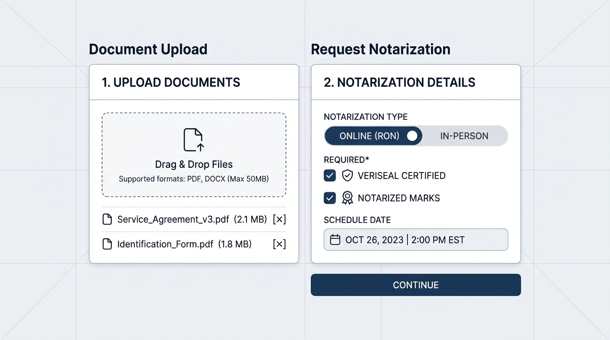

# VeriSeal — Digital & In-Person Notarization Platform

VeriSeal is a web-based notarization platform built with **React**, **TypeScript**, **Tailwind CSS**, **Web Crypto API (ECDSA P-256 + SHA-256)**, and **Firebase (Authentication + Cloud Firestore)**. It supports both **Remote Online Notarization (RON)** and **In-Person** appearances, multi-format document intake and folder organization, transparent notary stamp processing, tamper-evident chain-of-custody logging, and verifiable signing certificate issuance.

---

## Key Features

- **Cryptographic Signing & Timestamping (`src/lib/crypto.ts`)**
  - Computes exact **SHA-256** byte digests upon document upload.
  - Signs sealed records using **Web Crypto ECDSA (P-256 / SHA-256)** with exported JWK public keys and UTC ISO-8601 timestamps.
  - Maintains a hash-chained **Chain of Custody** ledger for every document lifecycle event.
- **Online (RON) & In-Person Notarization (`src/components/SigningRoomView.tsx`)**
  - **Online Mode**: Optional local camera preview, credential analysis, and Knowledge-Based Authentication (KBA).
  - **In-Person Mode**: Physical presence venue recording, ID inspection checklist, and statutory certificate wording.
  - **Electronic Signatures**: Draw signatures on an HTML5 canvas or type a legal signature.
- **Document & Folder Management (`src/components/DocumentManagerView.tsx`)**
  - Upload **PDF, DOCX, TXT, MD, CSV, PNG, or JPG** files, or start from legal templates (including the *VeriSeal Certified Official Logo & Mark Attestation* template).
  - Create, rename, and delete folders; filter by mode or 4-stage pipeline status (`Draft` → `ID Verified` → `Signer Executed` → `Notarized & Sealed`).
- **Transparent Notary Stamp Studio (`src/components/StampUploaderTool.tsx`)**
  - Upload an image of a physical notary stamp and automatically strip solid backgrounds into an alpha-transparent PNG overlay for documents and certificates.
- **VeriSeal Certified Logo & Notarized Official Mark (`src/components/VeriSealEmblems.tsx`)**
  - Dedicated vector emblems (**VeriSeal Certified** and framed **NOTARIZED** mark) with per-document toggles to include or omit them on documents, signing certificates, and exported HTML certificates.
- **Signing Certificates & Public Verification (`src/lib/certificateExport.ts`, `src/components/VerifyPortalView.tsx`)**
  - Immediately issues a **Certificate of Electronic Signing & Notarial Act** upon sealing.
  - Supports printing, downloading a self-contained HTML certificate, exporting a JSON proof bundle, and verifying any certificate code in the public verification portal.
- **Authentication & Persistence (`src/components/AuthModal.tsx`, `src/lib/firebase.ts`)**
  - Supports **Google Sign-In** and **Email/Password** registration, login, and password reset via Firebase Auth.
  - Syncs user profiles, folders, notarizations, custody events, journal entries, and verification records to Cloud Firestore (and includes an offline-friendly Local Preview Mode when signed out).

---

## How-To Guide (In-Person & Remote Signing)

See **[docs/HOW_TO_SIGN.md](docs/HOW_TO_SIGN.md)** for the full illustrated step-by-step walkthrough covering:
1. Uploading documents & selecting **Online (RON)** vs. **In-Person** mode
2. Completing **Remote Online Notarization** (A/V session, KBA, electronic signature)
3. Completing **In-Person Appearance** notarization (venue, physical ID inspection, electronic signature)
4. Issuing, downloading, and cryptographically verifying the **Signing Certificate**



---

## Tech Stack

- **Frontend**: React 19, TypeScript, Vite 8, Tailwind CSS v4, Lucide Icons
- **Cryptography**: Browser Web Crypto API (`SHA-256`, `ECDSA P-256`)
- **Backend / Persistence**: Firebase Authentication & Cloud Firestore
- **Security Validation**: `@firebase/eslint-plugin-security-rules` & `firestore.rules`

---

## Prerequisites

- **Node.js** `20.x` or later (`npm` included)
- **Git** (for cloning and pushing to GitHub)
- A **Firebase project** with **Cloud Firestore** and **Firebase Authentication** enabled (required for cloud sync; Local Preview Mode works out of the box without sign-in)

---

## Installation & Local Setup

### 1. Clone the repository

```bash
git clone https://github.com/<your-username>/<your-repo>.git
cd <your-repo>
```

### 2. Install dependencies

```bash
npm install
```

### 3. Configure Environment & Firebase

1. Copy `.env.example` to `.env` if needed for local environment overrides:

   ```bash
   cp .env.example .env
   ```

2. Ensure `firebase-applet-config.json` in the project root points to your Firebase Web App credentials and Firestore database ID:

   ```json
   {
     "apiKey": "YOUR_FIREBASE_API_KEY",
     "authDomain": "YOUR_PROJECT_ID.firebaseapp.com",
     "projectId": "YOUR_PROJECT_ID",
     "storageBucket": "YOUR_PROJECT_ID.firebasestorage.app",
     "messagingSenderId": "YOUR_SENDER_ID",
     "appId": "YOUR_APP_ID",
     "firestoreDatabaseId": "(default)"
   }
   ```

3. In the **Firebase Console**:
   - Enable **Authentication → Sign-in method → Google** (and optionally **Email/Password**).
   - Under **Authentication → Settings → Authorized domains**, ensure `localhost` as well as your preview or production hostnames (for example `*.run.app` or your custom domain) are authorized—without `https://` or port numbers. When running locally, open `http://localhost:3000` (or `http://localhost:3001`), **not** `http://127.0.0.1:...`, because Firebase Auth rejects IP addresses and port numbers.
   - Review and deploy `firestore.rules` to your Firestore database (using the Firebase CLI: `firebase deploy --only firestore:rules`).

### 4. Start the development server

```bash
npm run dev
```

Open [http://localhost:3000](http://localhost:3000) in your browser.

---

## Available Scripts

| Command | Description |
| :--- | :--- |
| `npm run dev` | Start the Vite development server on port `3000` |
| `npm run build` | Build the production bundle into `dist/` |
| `npm run preview` | Preview the production build locally |
| `npm run lint` | Run TypeScript type checking (`tsc --noEmit`) |
| `npx eslint firestore.rules` | Lint Firestore security rules |
| `npm run clean` | Remove `dist/` and temporary build artifacts |

---

## Project Structure

```text
.
├── firebase-applet-config.json   # Firebase client SDK configuration
├── firebase-blueprint.json       # Firestore data model blueprint
├── firestore.rules               # Cloud Firestore security rules
├── index.html                    # HTML entry point & typography fonts
├── package.json                  # Dependencies and npm scripts
├── vite.config.ts                # Vite configuration (port 3000)
└── src/
    ├── App.tsx                   # Main workspace, auth sync, and Firestore handlers
    ├── index.css                 # Tailwind CSS imports and print styles
    ├── types/
    │   └── notary.ts             # Shared TypeScript interfaces & validation bounds
    ├── lib/
    │   ├── certificateExport.ts  # Self-contained HTML signing certificate generator
    │   ├── crypto.ts             # SHA-256 hashing & ECDSA P-256 signing/verification
    │   ├── documentParser.ts     # Multi-format file reader & byte hashing
    │   ├── firebase.ts           # Firebase SDK initialization & error reporting
    │   ├── stampProcessor.ts     # Canvas background removal for transparent stamps
    │   └── templates.ts          # Legal templates & KBA verification questions
    └── components/
        ├── AuthModal.tsx         # Google Sign-In & Email/Password modal
        ├── DocumentManagerView.tsx # Upload dropzone, folders, and request queue
        ├── JournalView.tsx       # Statutory electronic notary journal
        ├── NotarySealSvg.tsx     # Dynamic SVG notary seal & custom PNG overlay
        ├── ProfileView.tsx       # Notary commission settings & stamp studio host
        ├── SigningRoomView.tsx   # Step-by-step ID, signature, seal & certificate room
        ├── StampUploaderTool.tsx # Interactive transparent notary stamp tool
        ├── VeriSealEmblems.tsx   # VeriSeal brand, VeriSeal Certified & Notarized SVGs
        └── VerifyPortalView.tsx  # Public certificate & signature verification portal
```

---

## Pushing to GitHub

If you downloaded this project locally and want to push it to a new GitHub repository:

```bash
git init
git branch -M main
git add .
git commit -m "Initial commit: VeriSeal notarization platform"
git remote add origin https://github.com/<your-username>/<your-repo>.git
git push -u origin main
```

> **Security Reminder:** Never commit private secrets or `.env` files (`.gitignore` already excludes `.env*`, `node_modules/`, and `dist/`). Review and tailor `firestore.rules` for your production requirements before sharing your deployment broadly.
