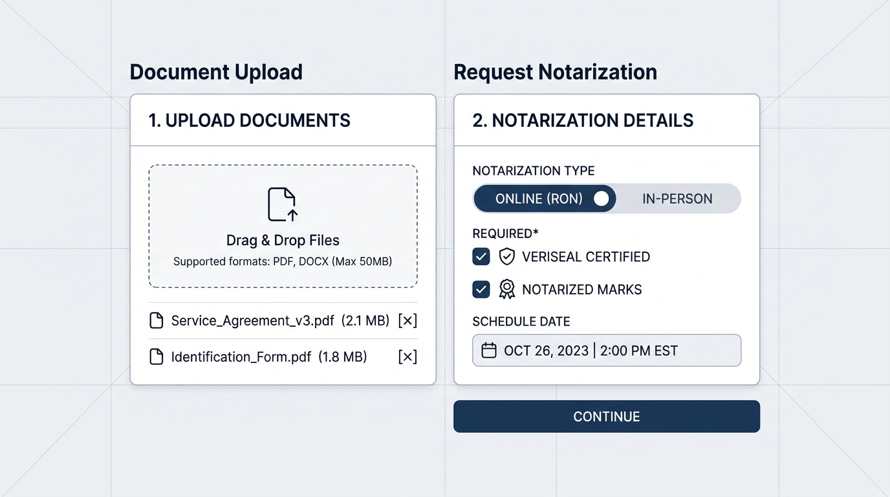
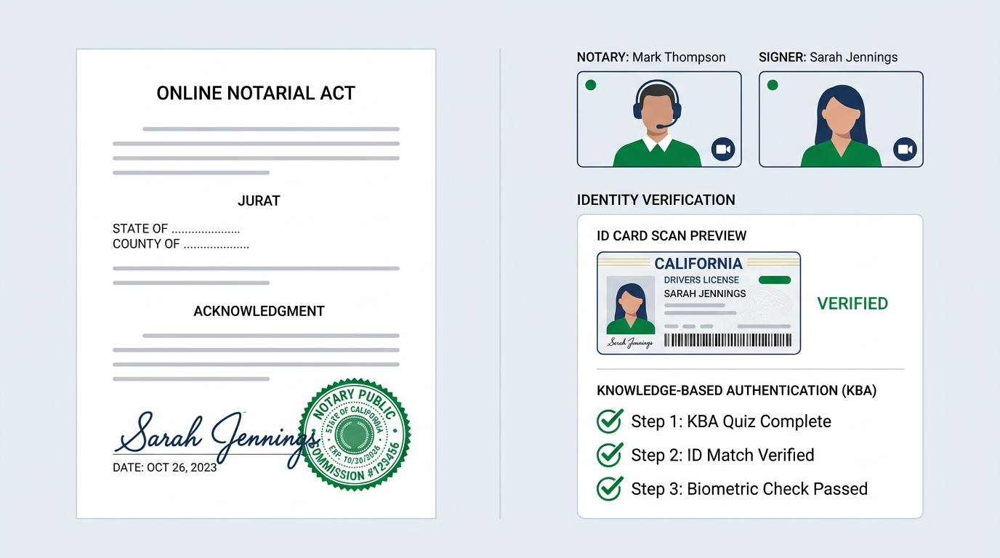
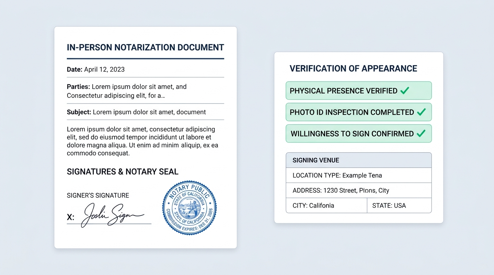
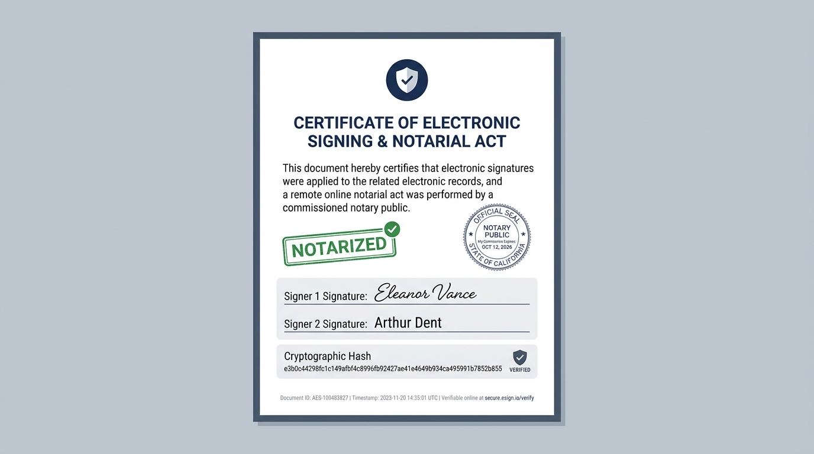

# How to Sign & Notarize a Document (In-Person & Remote Online)

This guide walks you through uploading a document in **VeriSeal**, completing **Remote Online Notarization (RON)** or **In-Person Appearance** signing, attaching optional **VeriSeal Certified** and **NOTARIZED** emblems, and issuing a verifiable **Signing Certificate**.

## Video Walkthrough (Online & In-Person)

- **[Watch / Download the In-Depth How-To Video (`veriseal-notary-walkthrough.mp4`)](veriseal-notary-walkthrough.mp4)** *(1080p MP4, ~72s, H.264)*

**Chapters covered in the video:**
1. **Overview & 4-Stage Pipeline** (`0:00`) — `Draft` → `ID Verified` → `Signer Executed` → `Notarized & Sealed`
2. **Pre-Session Setup** (`0:08`) — Authentication (`localhost:3000`), Commission Profile & Transparent Stamp Studio
3. **Document Intake & Emblems** (`0:16`) — Uploading PDF/DOCX/IMG, Mode Selection & **VeriSeal Certified** / **NOTARIZED** toggles
4. **Online Notarization (RON)** (`0:24`) — Live A/V Cam Check, KBA Verification, Electronic Signature & ECDSA Sealing
5. **In-Person Appearance** (`0:40`) — Physical Venue, Satisfactory Evidence, 3 Statutory Checks, On-Screen Signature & Journal
6. **Certificate Export & Public Verification** (`0:56`) — HTML Certificate, Proof JSON & Public Portal Check

---

## Step 1: Upload Your Document & Choose a Signing Mode

1. Open **Documents & Folders** in the left navigation.
2. Click **Select File** (or drag and drop a `.pdf`, `.docx`, `.txt`, `.md`, `.csv`, `.png`, or `.jpg` file onto the upload card), or choose a pre-built template such as **VeriSeal Certified Official Logo & Mark Attestation**.
3. Under **Notarization Mode**, select:
   - **Online (RON)** for remote two-way audio-video notarization.
   - **In-Person** for physical appearance at your office or signing venue (enter the **Physical Signing Venue / Address**).
4. Under **Official Emblems & Marks (Optional)**, check or uncheck:
   - **Add "VeriSeal Certified" Logo**
   - **Add "Notarized" Official Mark**
5. Click **Create Notarization Request** to compute the file's SHA-256 digest and open the **Signing Room**.

---

## Option A: How to Sign Remotely (Online RON)

Use **Online (RON)** when the principal signer appears via two-way audiovisual communication.

1. **Optional Camera Check**: In the **Remote Audio-Video Attestation** panel, click **Enable Cam** to preview your local camera feed alongside the commissioned notary tile.
2. **Identity & Credential Verification (Step 1)**:
   - Choose a verification method (e.g., *Government Photo ID + KBA* or *Passport + Credential Analysis*).
   - Complete the **Knowledge-Based Authentication (KBA)** questions (at least 2 of 3 correct answers required) and click **Confirm Identity & Pass KBA**.
3. **Electronic Signature (Step 2)**:
   - Choose **Draw Signature** to sign on the touch/mouse signature pad, or **Type Legal Name** to apply a typed legal signature.
   - Click **Apply Electronic Signature**.
4. **Apply Seal & Timestamp (Step 3)**:
   - Select **Vector SVG Seal** or **Uploaded PNG Stamp** (from **Profile & Stamp**).
   - Confirm whether to include the **VeriSeal Certified** logo and **NOTARIZED** mark.
   - Click **Issue Signing Certificate, Notary Seal & Timestamp**.

---

## Option B: How to Sign In-Person (Physical Appearance)

Use **In-Person** when the principal signer is physically present before the commissioned notary.

1. *(If a draft was created as Online)* Use the **Online / In-Person** switcher at the top of the session panel to set the session to **In-Person**.
2. **Physical Presence & ID Inspection (Step 1)**:
   - Confirm or edit the **Signing Venue / County & State** (e.g., `450 Mission St, San Francisco, CA`).
   - Select the **Satisfactory Evidence Presented** (Driver's License / State ID, Passport, Credible Witness, or Personal Knowledge).
   - Check all three statutory confirmations:
     - Principal signer is physically present before the notary.
     - Original photo ID inspected; unexpired, intact, and matches signer likeness.
     - Signer appears competent and executes the instrument willingly.
   - Click **Confirm Physical Presence & ID**.
3. **Electronic Signature (Step 2)**:
   - Have the signer draw their signature on the pad (mouse, trackpad, or touch) or type their legal name, then click **Apply Electronic Signature**.
4. **Apply Seal & Timestamp (Step 3)**:
   - Choose **Vector SVG Seal** or your transparent **Uploaded PNG Stamp**, verify your emblem checkboxes, and click **Issue Signing Certificate, Notary Seal & Timestamp**.

---

## Step 4: Issue, Download & Verify the Signing Certificate

Once sealed, VeriSeal automatically opens the **Certificate of Electronic Signing & Notarial Act** tab:

- **Download Certificate**: Saves a self-contained HTML certificate including the signer signature, notary seal/transparent PNG stamp, selected **VeriSeal Certified** / **NOTARIZED** emblems, SHA-256 digests, ECDSA P-256 signature, and full Chain of Custody log.
- **Print**: Opens a clean print layout containing only the formal sheet or certificate.
- **Proof JSON**: Exports the machine-verifiable cryptographic bundle (`certificateCode`, `signedPayload`, `digitalSignatureBase64`, `publicKeyJwk`).
- **Verify Signature in Public Portal**: Navigates to **Verify Document** and validates the ECDSA P-256 signature and SHA-256 digest independently.

